<!-- Hero: custom skyline (scripts/skyline.mjs). To switch back to the stock action, point the three paths at ./profile-3d-contrib/profile-night-view.svg (dark) and ./profile-3d-contrib/profile-gitblock.svg (light). -->
<picture>
  <source media="(prefers-color-scheme: dark)" srcset="./generated/skyline-dark.svg">
  <source media="(prefers-color-scheme: light)" srcset="./generated/skyline-light.svg">
  
</picture>

### Vitalii Borovyk

- Director of Frontend Engineering at [Talkable](https://www.talkable.com), referral and loyalty programs for 500+ US brands. Atlanta, GA.
- Author of [ebb-ai](https://github.com/Vitalini/ebb-ai), a carbon-aware MCP scheduler for agentic AI.
- Author of [Main Street AI](https://www.amazon.com/dp/B0H2RX8PXB) and The Word-of-Mouth Machine.
- Writes about AI in engineering teams: [How AI helps me at work](https://www.talkable.com/blog/how-ai-helps-team-manager).

### Open source

<!-- oss:start -->
<a href="https://github.com/search?q=is%3Apr%20author%3AVitalini%20is%3Amerged%20-org%3Atalkable%20-user%3AVitalini%20-repo%3ARepairex-rgb%2Frepairextech-1%20-repo%3Aimport-math%2Fsutra_video_infra%20-repo%3AGreen-Software-Foundation%2Fawesome-green-software%20-repo%3Apunkpeye%2Fawesome-mcp-servers%20-repo%3AComposioHQ%2Fawesome-claude-skills%20-repo%3Asegment-integrations%2Fanalytics.js-integration-curebit&type=pullrequests">
  <picture>
    <source media="(prefers-color-scheme: dark)" srcset="./generated/oss-dark.svg">
    <source media="(prefers-color-scheme: light)" srcset="./generated/oss-light.svg">
    
  </picture>
</a>

| Repository | Pull requests | Count |
|---|---|---|
| [activepieces/activepieces](https://github.com/activepieces/activepieces) | [#12390](https://github.com/activepieces/activepieces/pull/12390 "fix: prevent trigger badge from overlapping step name text") · [#8156](https://github.com/activepieces/activepieces/pull/8156 "feat(talkable): add custom field support to purchase and event actions") · [#8101](https://github.com/activepieces/activepieces/pull/8101 "feat(talkable): Add action claimOffer and refactoring") · [#5638](https://github.com/activepieces/activepieces/pull/5638 "chore(talkable): removed 'no error on failure' checkbox property") · [#3238](https://github.com/activepieces/activepieces/pull/3238 "feat(google-calendar): get all events action") · [#3062](https://github.com/activepieces/activepieces/pull/3062 "fix(talkable): rename package to fix tests and deploy") · [#3044](https://github.com/activepieces/activepieces/pull/3044 "feat(talkable): add \"No Error On Failure\" param for all actions") · [#2796](https://github.com/activepieces/activepieces/pull/2796 "feat(google-drive): added file content type to upload file action") · [#2760](https://github.com/activepieces/activepieces/pull/2760 "feat(Talkable): Add support of new param \"create_offers\" for Origin batch creation") · [#2444](https://github.com/activepieces/activepieces/pull/2444 "feat(talkable):  add find coupon / create event / create batch of events / create purchase / update person and more actions.") | 10 |
| [openclaw/openclaw](https://github.com/openclaw/openclaw) | [#73766](https://github.com/openclaw/openclaw/pull/73766 "fix(scripts): docs-spellcheck.sh fails on bash 3.2 (macOS); fix the 2 typos it surfaces") | 1 |
| [Shopify/hydrogen](https://github.com/Shopify/hydrogen) | [#3664](https://github.com/Shopify/hydrogen/pull/3664 "fix: use provided cartId in cartGetDefault before falling back to getCartId") | 1 |
| [n8n-io/n8n](https://github.com/n8n-io/n8n) | [#28042](https://github.com/n8n-io/n8n/pull/28042 "fix(MongoDB Chat Memory Node): Add connection pool limit") | 1 |
| [medusajs/medusa](https://github.com/medusajs/medusa) | [#15009](https://github.com/medusajs/medusa/pull/15009 "fix(admin): handle null sales channel references in product list and detail views") | 1 |
| [emmetio/emmet](https://github.com/emmetio/emmet) | [#155](https://github.com/emmetio/emmet/pull/155 "Update snippets.json") | 1 |
| In review | [calcom/cal.diy #28738](https://github.com/calcom/cal.diy/pull/28738 "fix: add @calcom/api-v2 to dev:api script") · [eivindfjeldstad/validate #129](https://github.com/eivindfjeldstad/validate/pull/129 "Add union types with type: { anyOf: [...] }") · [manaflow-ai/cmux #7994](https://github.com/manaflow-ai/cmux/pull/7994 "Add tab-name search to the workspace sidebar") · [manaflow-ai/cmux #7034](https://github.com/manaflow-ai/cmux/pull/7034 "Record muted workspace notifications in history as read") · [paperclipai/paperclip #15716](https://github.com/paperclipai/paperclip/pull/15716 "plugins: add Telegram Notifier plugin") · [vercel/next.js #92598](https://github.com/vercel/next.js/pull/92598 "fix(eslint-plugin-next): respect pageExtensions in no-html-link-for-pages rule") | 6 |
<!-- oss:end -->

### ebb-ai

[ebb-ai](https://github.com/Vitalini/ebb-ai) is a carbon-aware MCP scheduler for agentic AI. An agent hands it a task that can wait, and ebb-ai runs the task in the cleanest electricity-grid hour before the deadline. It ships as the npm package [`@ebb-ai/mcp`](https://www.npmjs.com/package/@ebb-ai/mcp) and is listed on [Glama](https://glama.ai/mcp/servers/Vitalini/ebb-ai) with an A score.

### Books and writing

- [Main Street AI: A Practical Guide to Running and Growing a Small Business with Artificial Intelligence](https://www.amazon.com/dp/B0H2RX8PXB)
- The Word-of-Mouth Machine: A Practical Guide to Growing an Online Store with Referrals, Retention, and AI
- [How AI Helps Me at Work: A Developer and Team Manager's Experience](https://www.talkable.com/blog/how-ai-helps-team-manager) (Talkable blog)

[LinkedIn](https://www.linkedin.com/in/vitalini)
