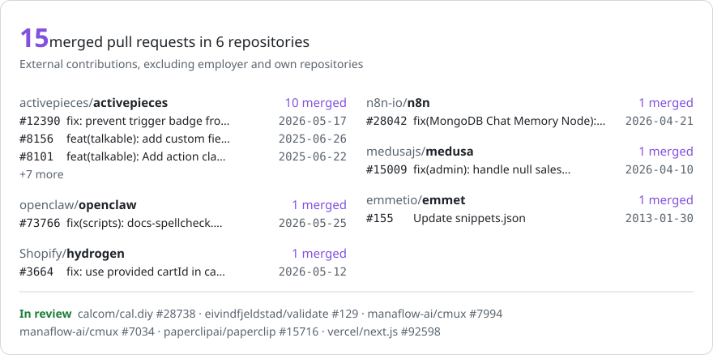

<picture>
  <source media="(prefers-color-scheme: dark)" srcset="./generated/yearwalk-dark.svg">
  <source media="(prefers-color-scheme: light)" srcset="./generated/yearwalk-light.svg">
  
</picture>

### Vitalii Borovyk

- Director of Frontend Engineering at [Talkable](https://www.talkable.com), referral and loyalty programs for 500+ US brands. Atlanta, GA.
- Author of [EBB AI](https://ebb-ai.com), a carbon-aware MCP scheduler for agentic AI.
- Author of the [Practical AI](https://www.amazon.com/stores/Vitalii-Borovyk/author/B0H24CJSV3) book series about using AI at work and in everyday life.
- Writes about AI in engineering teams: [How AI helps me at work](https://www.talkable.com/blog/how-ai-helps-team-manager).

### Open source

<!-- oss:start -->
<a href="https://github.com/search?q=is%3Apr%20author%3AVitalini%20-org%3Atalkable%20-user%3AVitalini%20-repo%3ARepairex-rgb%2Frepairextech-1%20-repo%3Aimport-math%2Fsutra_video_infra%20-repo%3AGreen-Software-Foundation%2Fawesome-green-software%20-repo%3Apunkpeye%2Fawesome-mcp-servers%20-repo%3AComposioHQ%2Fawesome-claude-skills%20-repo%3Asegment-integrations%2Fanalytics.js-integration-curebit&type=pullrequests" title="All my external pull requests on GitHub">
  <picture>
    <source media="(prefers-color-scheme: dark)" srcset="./generated/oss-dark.svg">
    <source media="(prefers-color-scheme: light)" srcset="./generated/oss-light.svg">
    
  </picture>
</a>
<!-- oss:end -->

### EBB AI

[EBB AI](https://ebb-ai.com) is a carbon-aware MCP scheduler for agentic AI. An agent hands it a task that can wait, and EBB AI runs the task in the cleanest electricity-grid hour before the deadline. Source on [GitHub](https://github.com/Vitalini/ebb-ai); it ships as the npm package [`@ebb-ai/mcp`](https://www.npmjs.com/package/@ebb-ai/mcp) and is listed on [Glama](https://glama.ai/mcp/servers/Vitalini/ebb-ai) with an A score.

### Books and writing

- [Living with OpenClaw](https://www.amazon.com/dp/B0GZ1C497S)
- [The Resilient Career](https://www.amazon.com/dp/B0H3F8BK54)
- [100 Prompts You'll Actually Use](https://www.amazon.com/dp/B0H3F3K1C1)
- [Main Street AI](https://www.amazon.com/dp/B0H3F21B84)
- [Outsmart AI Scams](https://www.amazon.com/dp/B0H2Y53F8G)
- [The AI Slash-Command Handbook](https://www.amazon.com/dp/B0H2H7TN9Z)
- [The Prompt](https://www.amazon.com/dp/B0H2M1XPT7)
- [AI at Work](https://www.amazon.com/dp/B0H2LWQ2S3)
- [AI Agents, Made Simple](https://www.amazon.com/dp/B0H2LPMWJ1)
- [AI for Creators](https://www.amazon.com/dp/B0H2LP4QR6)
- [Talking to AI](https://www.amazon.com/dp/B0H2LLTDT8)
- [Which AI Should I Use?](https://www.amazon.com/dp/B0H2DM8F6W)
- [All books on Amazon](https://www.amazon.com/stores/Vitalii-Borovyk/author/B0H24CJSV3)

[How AI Helps Me at Work: A Developer and Team Manager's Experience](https://www.talkable.com/blog/how-ai-helps-team-manager) (Talkable blog)

[LinkedIn](https://www.linkedin.com/in/vitalini)
